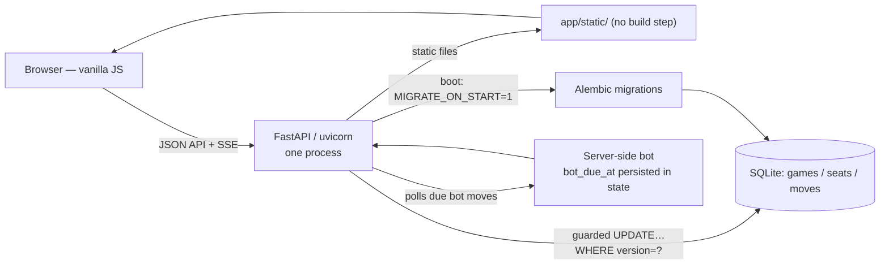
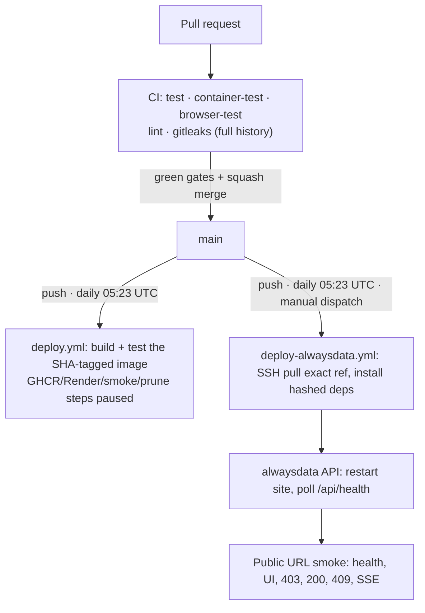

# Flop7

A browser-based, multi-player push-your-luck card game with live updates and per-seat tokens — no accounts, no login.

## Status

Complete and tagged `v1.0.0`. The live service is <https://gstavrooo.alwaysdata.net>; the former
Render deployment is **paused** (setup retained).
The specification that drove the build (`FLOP7-SPEC.md`) and the phase prompts are kept on the
owner's machine and are deliberately not part of this repository.

## Product and rules

2–6 players (hot-seat on one device or via invite links), optionally with one server-side bot. One
public HTTPS URL, open to anyone; **each seat** is protected by a secret token, so a game id alone
never grants control. No accounts, profiles, payments or chat.

- **Deck:** 94 cards — 79 numbered (`0`×1, `1`×1, `2`×2 … `12`×12), six Score Modifiers
  (`+2` … `+10`, `x2`) and nine Action cards (Freeze, Flip Three, Second Chance ×3). The deck is
  shuffled once; the discard pile is reshuffled when it empties. Empty deck + discard = illegal move.
- **Turn:** every round starts with one face-up card dealt to each player (action cards in the deal
  resolve immediately). Then you **hit once (draw one card) or stay**, and the turn passes to the
  next active player — so players, including the bot, alternate card by card. Staying banks your
  score and sits you out for the rest of the round. Drawing a number you already hold busts you (0
  for the round) unless a one-shot Second Chance absorbs it — and using it **ends that card's turn**
  while keeping you in the round. `x2` doubles the sum of numbers, then `+N` modifiers are added.
  Seven different numbers in hand = **Flip 7** (+15, ends the round for all).
- **Actions:** any active player may be targeted, **including yourself**. Freeze banks the target;
  Flip Three lets a target draw up to three cards (action cards are queued for them afterwards);
  Second Chance protects once and is passed on if already held.
  Actions with zero or one valid target resolve automatically; the rest wait in a pending queue.
- **Round and win:** after the round break any token holder explicitly starts the next round; the
  starting seat rotates. Scores carry over; sole leader at ≥ 200 wins — ties play on.

These follow the publisher's rules (opening deal, self-targeting, Second Chance ending the turn).
The deliberate adaptations are **2–6 seats instead of 3–18** and the optional bot for solo play.
Flop7 is an **unofficial, non-commercial fan adaptation** and is not affiliated with, endorsed by,
or connected to the publisher of Flip 7.
- **Bot:** optional, appended last, never sees the deck. On each of its turns it stays at ≥ 18
  points or ≥ 4 numbers (otherwise hits one card), targets the strongest opponent, and pauses a
  persisted 1.5 s between decisions so refreshes and multiple viewers cannot duplicate or skip a
  move. Solo human + bot alternates one card at a time.

## Stack

| Concern | Choice |
| --- | --- |
| Runtime | FastAPI, uvicorn; Python 3.14 venv on the live host, 3.15 slim container (digest-pinned) for CI |
| Frontend | Vanilla JS/CSS in `app/static/`, no build step, no npm |
| Storage | SQLite file via SQLAlchemy Core; Alembic migrations applied on boot |
| Hosting | alwaysdata free plan, one *User program* site; Render free tier paused (setup retained) |
| Dependencies | `requirements.in` / `requirements-dev.in` compiled to hashed lockfiles with pip-tools |
| Quality gates | pytest, Playwright browser regressions, container smoke + Trivy, ruff, shellcheck, actionlint, zizmor, gitleaks |

## Architecture

One small process: FastAPI serves both the JSON API and the built-less static frontend. The entire
game (including the hidden deck) lives in one JSON column; seat tokens are stored only as digests in
a separate table.



Client state is the public view only: no deck, but `deck_count`, per-player derived scores, valid
`targets`, `version`, structured events and round results. Version-checked writes make double clicks
and stale clients harmless (409 → reload).

## Deployment pipeline



Every merge to `main` deploys the exact merged commit to alwaysdata automatically; the daily
05:23 UTC run catches Dependabot merges, which fire no push event. Manual dispatch redeploys `main`
or another ref. A failed public smoke leaves a red run — the fix is a new commit, never an automatic rollback.

## Local development

Requires Python 3.14 (the lockfiles are hashed for that interpreter; the container uses 3.15).

```sh
python3 -m venv .venv
.venv/bin/python -m pip install --require-hashes -r requirements-dev.txt
```

Run every check locally:

```sh
.venv/bin/ruff check .
.venv/bin/ruff format --check .
.venv/bin/python -m pytest -q                        # 86 tests
.venv/bin/python -m playwright install chromium      # once
.venv/bin/python tests/browser_checks.py             # 43 named scenarios, ~25 s
```

After editing a `*.in` file, recompile both lockfiles (runtime first — the dev file includes it):

```sh
.venv/bin/python -m piptools compile --generate-hashes --no-strip-extras -o requirements.txt requirements.in
.venv/bin/python -m piptools compile --generate-hashes --allow-unsafe --no-strip-extras -o requirements-dev.txt requirements-dev.in
```

## Running

uvicorn serves the JSON API and the static files from one app. `DATABASE_URL` defaults to
`sqlite:///flop7.db`; `PORT` defaults to `8080`. Set `MIGRATE_ON_START=1` to apply Alembic
migrations before serving (the app refuses to start against a legacy, unmigrated schema):

```sh
MIGRATE_ON_START=1 .venv/bin/python -m uvicorn app.main:app --host 0.0.0.0 --port "${PORT:-8080}"
```

Endpoints: `POST /api/games`, `POST /api/games/{id}/{hit,stay,next,target}`, `GET /api/games/{id}`,
`GET /api/games/{id}/events?seconds=N` (SSE), `GET /api/health`, plus the static root. Seat tokens
are returned only in the create response and must be sent back in the `X-Seat-Token` header; a stale
`version` yields 409.

The frontend at `/` is a single page: create a game (optionally hot-seat and/or with a bot), then
hand out the per-seat invite links from the Invite dialog. Invite tokens travel only in the URL
fragment, which the app strips from the address bar after reading; tokens for "your" seats persist
in namespaced local storage and degrade to session-only if storage is blocked or corrupt.
Language (de/en), theme (light/dark) and sound are global preferences, persisted and applied
before first paint. Keyboard shortcuts: `H`/`Space` hit, `S` stay, `1..6` choose a target, `?`
opens the rules; shortcuts are ignored in inputs, textareas and open dialogs.

## CI and branching

[`.github/workflows/ci.yml`](.github/workflows/ci.yml) runs on every pull request with all five
gates from the spec: `test` (pytest from the hashed dev lockfile), `container-test`
(`scripts/test-image.sh`: build, HTTP smoke via `scripts/smoke.sh`, Trivy fixable HIGH/CRITICAL scan
with `.trivyignore`), `browser-test` (Playwright/Chromium on pinned `ubuntu-24.04`, mobile and
desktop, no screenshots/traces), `lint` (ruff, shellcheck, actionlint, zizmor offline) and
`gitleaks` (whole history). All actions and tool images are pinned by SHA/digest.

Branches are trunk-based: squash-merge only, linear history, no direct pushes to `main`. PRs are
merged with `gh pr merge <nr> --auto --squash`. GitHub does not always accept `--auto` in this free
tier repository; if it is rejected, use `gh pr merge <nr> --squash` once the gates are green.
The PR still runs all five gates; confirm they are green after merging (or watch the follow-up
checks). Green checks never replace reading the diff.

[`.github/dependabot.yml`](.github/dependabot.yml) opens grouped weekly PRs for pip, GitHub
Actions and the Docker digest. [`.github/workflows/dependabot-automerge.yml`](.github/workflows/dependabot-automerge.yml)
opts those PRs into auto-merge for **patch/minor** updates only (squash); majors stay manual.

## Deployment

The live service is <https://gstavrooo.alwaysdata.net> (alwaysdata free Public Cloud plan, one
*User program* site, Python 3.14 venv, its own SQLite file at `~/flop7/data/flop7.db`). Idle time is
set to `0` in the site's advanced settings, so the process is not stopped for inactivity; HTTPS is
forced by alwaysdata's wildcard certificate.

[`.github/workflows/deploy-alwaysdata.yml`](.github/workflows/deploy-alwaysdata.yml) is the only
deployment path. It runs on every push to `main` (docs-only changes excluded), daily at 05:23 UTC
as a Dependabot catch-up, and on manual dispatch for ad-hoc refs:

```sh
gh workflow run deploy-alwaysdata.yml -R gstavrooo/flop7 -f ref=main   # optional: another branch/SHA
```

The job checks out that ref, pulls it on the host over SSH, reinstalls the hashed runtime
dependencies, restarts the site via `scripts/alwaysdata_deploy.py` (alwaysdata API: find the site by
address, `POST /site/<id>/restart/`, poll `/api/health`), then runs `scripts/smoke.sh` against the
public URL. Secrets: `ALWAYS_DATA_API_KEY`, `ALWAYS_DATA_SSH_KEY`; variable `ALWAYS_DATA_ACCOUNT`.
The repo has a read-only GitHub deploy key for remote pulls; the CI SSH key is stored as a secret.

### Render (paused, setup retained)

The former host <https://flop7-01ed.onrender.com> is no longer deployed to. The GHCR push, Render
deploy, public smoke and image-prune steps in
[`.github/workflows/deploy.yml`](.github/workflows/deploy.yml) are guarded by the repository
variable `RENDER_DEPLOY_ENABLED` (currently `false`); the build and image-test steps still run on
pushes to `main`. The Render service, `scripts/render_deploy.py` and the `RENDER_*` secrets/variables
are deliberately kept so setting that variable to `true` reactivates the setup without rebuilding
it. The old Render instance may still answer with its last deployed snapshot, but it receives no
updates and its ephemeral DB is unrelated to the live data.

One-time prerequisites for the current host:

1. An alwaysdata account on the free Public Cloud plan (1 GB disk, 256 MB RAM, non-commercial use,
   only the account's own `*.alwaysdata.net` address — no custom domain and no Docker).
2. SSH access with a key, a read-only GitHub deploy key on the private repo for `git pull`, and a
   second SSH key for GitHub Actions stored as `ALWAYS_DATA_SSH_KEY`.
3. An alwaysdata API token (requires 2FA) stored as `ALWAYS_DATA_API_KEY`; the account name is the
   variable `ALWAYS_DATA_ACCOUNT`.
4. The site itself is created once in the admin as type *User program* (the command runs uvicorn
   from `.venv/bin/python` on `$IP`/`$PORT`), working directory `flop7`, `MIGRATE_ON_START=1`, HTTPS
   forced and idle time `0`.

## Runbook

```sh
gh run list --limit 10                                    # recent CI / Deploy runs
gh run view <id> --log-failed                             # logs only when something is red
gh workflow run deploy-alwaysdata.yml -f ref=main         # manual redeploy / ad-hoc ref
curl -fsS https://gstavrooo.alwaysdata.net/api/health     # live health
ssh gstavrooo@ssh-gstavrooo.alwaysdata.net 'tail -50 ~/admin/logs/sites/1108351.log'  # site log
gitleaks detect --source=. --config=gitleaks.toml --no-banner   # full history (CI fetches all refs)
```

- All gates are green on the tagged commit; the last public smoke passed against the live service.
- No auto-rollback: diagnose the red run, fix forward and redeploy. Redeploying does **not** clear
  the alwaysdata DB; delete `~/flop7/data/flop7.db` deliberately if a reset is wanted.
- Rotate `ALWAYS_DATA_API_KEY` or `ALWAYS_DATA_SSH_KEY` in GitHub secrets if a credential leaks.
- The idle-time setting and the site/venv/DB live on the host, not in this repo.

## Security model

- Seats are authorised by `secrets.token_urlsafe(16)` tokens returned **once** in the create
  response, stored only as SHA-256 digests and compared with `hmac.compare_digest`. Tokens are never
  logged or returned again; a wrong/absent token is a 403.
- Invite links carry the token in the URL **fragment** (`…?game=<id>#seat=<n>&token=<t>`), which is
  never sent to the server, and the app strips it from the address bar after reading it.
- All responses carry locked-down headers (`X-Content-Type-Options`, `Referrer-Policy`, strict CSP,
  frame-busting); HTML and static assets use revalidation so deploys appear without a hard reload.
- No login and no privileged endpoints: knowing a game id only reveals that game's public view.
- In-process rate limits per visitor IP: 30 game creations/minute and 10 concurrent SSE streams by
  default (`RATE_CREATE_PER_MIN` / `RATE_SSE_MAX_PER_IP`; `0` disables either). Breaches get 429 with
  `Retry-After`. Limits are per worker and reset on restart; they are abuse guards, not quotas.
- The SQLite file has no network exposure. The CI container runs as `nobody` with `pip` removed;
  the live host runs the same hashed runtime dependencies in a per-account venv. No secrets, keys
  or credentials live in the repo — gitleaks scans the whole history on every PR.

## Trade-offs

- **Durable data:** the SQLite file now lives in the alwaysdata account home, so game data survives
  redeploys and restarts (the free plan includes 3-day backups). Delete it deliberately to reset.
- **No cold start:** idle time is `0`, so the site is not stopped for inactivity; alwaysdata can
  still restart processes during maintenance, and the SSE reconnect chip covers brief gaps.
- **No auto-rollback:** a failed deploy leaves a red CI/CD run and a fix-forward commit; it never
  silently reverts an older version.
- **Manual first deploy:** the alwaysdata site, venv, API token and SSH/deploy keys were created by
  hand; code deploys then follow every merge to `main` automatically.
- **Free-plan limits:** 1 GB disk, 256 MB RAM, ¼ CPU, one site at the account address, no Docker or
  custom domain, non-commercial use; shared-host contention can still affect latency.
- **SQLite + polling SSE:** version-checked writes and polling avoid queues and extra services at
  the cost of one request per viewer per second; bot decisions are driven by viewers' polls.
- **Public-repo CI:** pull-request workflows use least-privilege tokens and never receive deploy
  secrets; deploy workflows run only on trusted `main` pushes, the daily schedule or manual
  dispatch, never on pull requests. Required status checks and branch protection can be enabled
  once the repository is public.

## What I would change at scale

- **Push instead of poll:** replace the one-poll-per-viewer SSE loop with a DB-notify mechanism
  (Postgres `LISTEN/NOTIFY` or a small pub/sub broker) and WebSockets; persist bot due times in a
  job table rather than relying on viewers' requests to drive moves.
- **Durable storage:** the SQLite file is now persistent on alwaysdata with short backups; at scale,
  move the single JSON column to managed Postgres with PITR and put static assets on a CDN. Keep
  Alembic as the schema gate.
- **Horizontal scaling:** share state via the database/cache, add advisory locks for moves, and
  keep the app stateless (it already is apart from the SQLite file).
- **Hardening and observability:** signed, expiring invite tokens, shared/per-account rate limits
  instead of per-process counters, structured logs and metrics/alerting; upgrade image retention to a
  proper registry lifecycle.

## Licensing

GPL-3.0 — see [`LICENSE`](LICENSE). The vendored QR generator is MIT-licensed (header in
`app/static/qrcode.js`).
