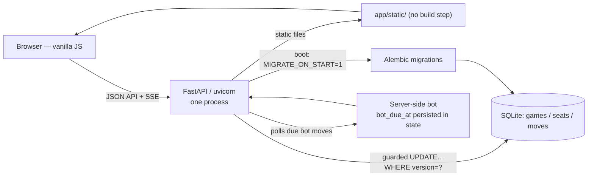
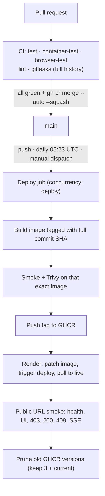

# Flop7

A browser-based, multi-player push-your-luck card game with live updates and per-seat tokens — no accounts, no login.

## Status

Complete and tagged `v1.0.0`; the repository is still **private**. The specification that drove the
build (`FLOP7-SPEC.md`) and the phase prompts are kept on the owner's machine and are deliberately
not part of this repository.

## Product and rules

2–6 players (hot-seat on one device or via invite links), optionally with one server-side bot. One
public HTTPS URL, open to anyone; **each seat** is protected by a secret token, so a game id alone
never grants control. No accounts, profiles, payments or chat.

- **Deck:** 94 cards — 79 numbered (`0`×1, `1`×1, `2`×2 … `12`×12), six Score Modifiers
  (`+2` … `+10`, `x2`) and nine Action cards (Freeze, Flip Three, Second Chance ×3). The deck is
  shuffled once; the discard pile is reshuffled when it empties. Empty deck + discard = illegal move.
- **Turn:** every round starts with one face-up card dealt to each player (action cards in the deal
  resolve immediately). Then you **hit once (draw one card) or stay**, and the turn passes to the
  next active player — so players, including the bot, alternate card by card. Staying banks your
  score and sits you out for the rest of the round. Drawing a number you already hold busts you (0
  for the round) unless a one-shot Second Chance absorbs it — and using it **ends that card's turn**
  while keeping you in the round. `x2` doubles the sum of numbers, then `+N` modifiers are added.
  Seven different numbers in hand = **Flip 7** (+15, ends the round for all).
- **Actions:** any active player may be targeted, **including yourself**. Freeze banks the target;
  Flip Three lets a target draw up to three cards (action cards are queued for them afterwards);
  Second Chance protects once and is passed on if already held.
  Actions with zero or one valid target resolve automatically; the rest wait in a pending queue.
- **Round and win:** after the round break any token holder explicitly starts the next round; the
  starting seat rotates. Scores carry over; sole leader at ≥ 200 wins — ties play on.

These follow the publisher's rules (opening deal, self-targeting, Second Chance ending the turn).
The deliberate adaptations are **2–6 seats instead of 3–18** and the optional bot for solo play.
- **Bot:** optional, appended last, never sees the deck. On each of its turns it stays at ≥ 18
  points or ≥ 4 numbers (otherwise hits one card), targets the strongest opponent, and pauses a
  persisted 1.5 s between decisions so refreshes and multiple viewers cannot duplicate or skip a
  move. Solo human + bot alternates one card at a time.

## Stack

| Concern | Choice |
| --- | --- |
| Runtime | FastAPI, uvicorn; Python 3.15 slim in the container (digest-pinned), CI/lockfiles on 3.14 |
| Frontend | Vanilla JS/CSS in `app/static/`, no build step, no npm |
| Storage | SQLite file via SQLAlchemy Core; Alembic migrations applied on boot |
| Hosting | Render free tier, region Frankfurt; image in GHCR, base image pinned by digest |
| Dependencies | `requirements.in` / `requirements-dev.in` compiled to hashed lockfiles with pip-tools |
| Quality gates | pytest, Playwright browser regressions, container smoke + Trivy, ruff, shellcheck, actionlint, zizmor, gitleaks |

## Architecture

One small process: FastAPI serves both the JSON API and the built-less static frontend. The entire
game (including the hidden deck) lives in one JSON column; seat tokens are stored only as digests in
a separate table.



Client state is the public view only: no deck, but `deck_count`, per-player derived scores, valid
`targets`, `version`, structured events and round results. Version-checked writes make double clicks
and stale clients harmless (409 → reload).

## Deployment pipeline



Bot merges do not fire a `push` event, so the daily schedule deploys them within 24 h; a manual
dispatch deploys immediately. A failed public smoke leaves a red run — the fix is a new commit, never
an automatic rollback.

## Local development

Requires Python 3.14 (the lockfiles are hashed for that interpreter; the container uses 3.15).

```sh
python3 -m venv .venv
.venv/bin/python -m pip install --require-hashes -r requirements-dev.txt
```

Run every check locally:

```sh
.venv/bin/ruff check .
.venv/bin/ruff format --check .
.venv/bin/python -m pytest -q                        # 86 tests
.venv/bin/python -m playwright install chromium      # once
.venv/bin/python tests/browser_checks.py             # 33 named scenarios, ~25 s
```

After editing a `*.in` file, recompile both lockfiles (runtime first — the dev file includes it):

```sh
.venv/bin/python -m piptools compile --generate-hashes --no-strip-extras -o requirements.txt requirements.in
.venv/bin/python -m piptools compile --generate-hashes --allow-unsafe --no-strip-extras -o requirements-dev.txt requirements-dev.in
```

## Running

uvicorn serves the JSON API and the static files from one app. `DATABASE_URL` defaults to
`sqlite:///flop7.db`; `PORT` defaults to `8080`. Set `MIGRATE_ON_START=1` to apply Alembic
migrations before serving (the app refuses to start against a legacy, unmigrated schema):

```sh
MIGRATE_ON_START=1 .venv/bin/python -m uvicorn app.main:app --host 0.0.0.0 --port "${PORT:-8080}"
```

Endpoints: `POST /api/games`, `POST /api/games/{id}/{hit,stay,next,target}`, `GET /api/games/{id}`,
`GET /api/games/{id}/events?seconds=N` (SSE), `GET /api/health`, plus the static root. Seat tokens
are returned only in the create response and must be sent back in the `X-Seat-Token` header; a stale
`version` yields 409.

The frontend at `/` is a single page: create a game (optionally hot-seat and/or with a bot), then
hand out the per-seat invite links from the Invite dialog. Invite tokens travel only in the URL
fragment, which the app strips from the address bar after reading; tokens for "your" seats persist
in namespaced local storage and degrade to session-only if storage is blocked or corrupt.
Language (de/en), theme (auto/light/dark) and sound are global preferences, persisted and applied
before first paint. Keyboard shortcuts: `H`/`Space` hit, `S` stay, `1..6` choose a target, `?`
opens the rules; shortcuts are ignored in inputs, textareas and open dialogs.

## CI and branching

[`.github/workflows/ci.yml`](.github/workflows/ci.yml) runs on every pull request with all five
gates from the spec: `test` (pytest from the hashed dev lockfile), `container-test`
(`scripts/test-image.sh`: build, HTTP smoke via `scripts/smoke.sh`, Trivy fixable HIGH/CRITICAL scan
with `.trivyignore`), `browser-test` (Playwright/Chromium on pinned `ubuntu-24.04`, mobile and
desktop, no screenshots/traces), `lint` (ruff, shellcheck, actionlint, zizmor offline) and
`gitleaks` (whole history). All actions and tool images are pinned by SHA/digest.

Branches are trunk-based: squash-merge only, linear history, no direct pushes to `main`. PRs are
merged with `gh pr merge <nr> --auto --squash`. This free private-tier repository has
`allow_auto_merge: false` and cannot require status checks, so that request **completes as an
immediate squash merge** rather than waiting for gates. The PR still runs all five gates; confirm
they are green after merging (or watch the follow-up checks). Green checks never replace reading
the diff.

[`.github/dependabot.yml`](.github/dependabot.yml) opens grouped weekly PRs for pip, GitHub
Actions and the Docker digest. [`.github/workflows/dependabot-automerge.yml`](.github/workflows/dependabot-automerge.yml)
opts those PRs into auto-merge for **patch/minor** updates only (squash); majors stay manual.

## Deployment

The live service is <https://flop7-01ed.onrender.com> (free plan, Frankfurt; ephemeral DB).

[`.github/workflows/deploy.yml`](.github/workflows/deploy.yml) runs on every push to `main`
(Markdown-only changes are skipped via `paths-ignore: ["**.md"]`), on manual dispatch, and on a
daily schedule at 05:23 UTC:

```sh
gh workflow run deploy.yml --ref main
```

The single job builds the image for `linux/amd64`, smoke-tests that exact image and Trivy-scans it
via `scripts/test-image.sh`, pushes it to `ghcr.io/<owner>/flop7:<full-commit-sha>` with
`packages: write`, then uses `scripts/render_deploy.py` to find-or-create the Render service
(`flop7`, `free`, `frankfurt`, auto-deploy off), patch its image, trigger a deploy of exactly that
tag and poll to `live`. Finally `scripts/smoke.sh` checks the public URL (health, frontend, create,
403, 200, 409, SSE) and `scripts/prune_ghcr.py` prunes old images. Values move between steps via
env/outputs, never interpolated into `run:`.

Prerequisites (one-time, manual):

1. A free Render account in the Frankfurt region.
2. A Render API key with service read/write and registry-credential read access, stored as the
   repository secret `RENDER_API_KEY` (verify with `gh secret list`).
3. For the private GHCR image: a Render **Registry Credential** using a GitHub PAT with
   `read:packages`. The deploy script picks the single GitHub credential automatically; if there
   are several, set the repository variable `RENDER_REGISTRY_CREDENTIAL_ID`.
4. If the API key sees several workspaces, set the repository variable `RENDER_OWNER_ID`.

**Image retention:** GHCR keeps only the three newest SHA-tagged versions; the tag being deployed
is always protected. This stays inside the ~500 MB free private-package allowance, and Render
pulls the image on every deploy/restart, so older versions are never needed at runtime.

## Runbook

```sh
gh run list --limit 10                       # recent CI / Deploy runs
gh run view <id> --log-failed                # logs only when something is red
gh workflow run deploy.yml --ref main        # deploy the current main now
curl -fsS https://flop7-01ed.onrender.com/api/health
gitleaks detect --source=. --config=gitleaks.toml --no-banner   # full history (CI fetches all refs)
```

- All gates are green on the tagged commit; the last public smoke passed against the live service.
- No auto-rollback: diagnose the red run, fix forward and redeploy. Redeploying discards game data.
- Rotate `RENDER_API_KEY` or the registry PAT in GitHub repository secrets if a credential leaks.

## Security model

- Seats are authorised by `secrets.token_urlsafe(16)` tokens returned **once** in the create
  response, stored only as SHA-256 digests and compared with `hmac.compare_digest`. Tokens are never
  logged or returned again; a wrong/absent token is a 403.
- Invite links carry the token in the URL **fragment** (`…?game=<id>#seat=<n>&token=<t>`), which is
  never sent to the server, and the app strips it from the address bar after reading it.
- All responses carry locked-down headers (`X-Content-Type-Options`, `Referrer-Policy`, strict CSP,
  frame-busting); HTML and static assets use revalidation so deploys appear without a hard reload.
- No login and no privileged endpoints: knowing a game id only reveals that game's public view.
- The SQLite file has no network exposure; the container runs as `nobody`, with `pip` removed and
  hashed runtime dependencies only. No secrets, keys or credentials live in the repo — gitleaks
  scans the whole history on every PR.

## Trade-offs

- **Ephemeral data:** the Render free tier loses the filesystem on redeploy, restart or
  scale-to-zero. Game data is not durable — a deliberate choice for zero-cost hosting.
- **Cold starts:** after roughly 15 minutes idle the first request takes about a minute to wake
  the instance. The SSE reconnect chip and automatic reconnect cover this gracefully.
- **No auto-rollback:** a failed deploy leaves a red CI/CD run and a fix-forward commit; it never
  silently reverts to an older image.
- **Manual first deploy:** the service and registry credential were created once by hand via the
  Render API/UI; only subsequent deploys are automated.
- **Dependabot catch-up delay:** a bot merge deploys on the next 05:23 UTC scheduled run, so a
  dependency bump can take up to ~24 h to reach production; dispatch the workflow to deploy now.
- **SQLite + polling SSE:** version-checked writes and polling avoid queues and extra services at
  the cost of one request per viewer per second; bot decisions are driven by viewers' polls.
- **Private-repo CI limits:** the free private tier cannot use branch-protection required checks or
  GitHub's auto-merge setting, so merges rely on green gates plus an explicitly enabled auto-merge.

## What I would change at scale

- **Push instead of poll:** replace the one-poll-per-viewer SSE loop with a DB-notify mechanism
  (Postgres `LISTEN/NOTIFY` or a small pub/sub broker) and WebSockets; persist bot due times in a
  job table rather than relying on viewers' requests to drive moves.
- **Durable storage:** move the single JSON column to managed Postgres with real backups/PITR and
  put static assets on a CDN; keep Alembic as the schema gate. This removes the ephemeral-data and
  cold-start trade-offs.
- **Horizontal scaling:** share state via the database/cache, add advisory locks for moves, and
  make the container stateless (it already is).
- **Hardening and observability:** signed, expiring invite tokens, rate limiting per id/IP,
  structured logs and metrics/alerting; upgrade image retention to a proper registry lifecycle.

## Licensing

GPL-3.0 — see [`LICENSE`](LICENSE). The repository remains private; publishing is a separate,
later decision.
